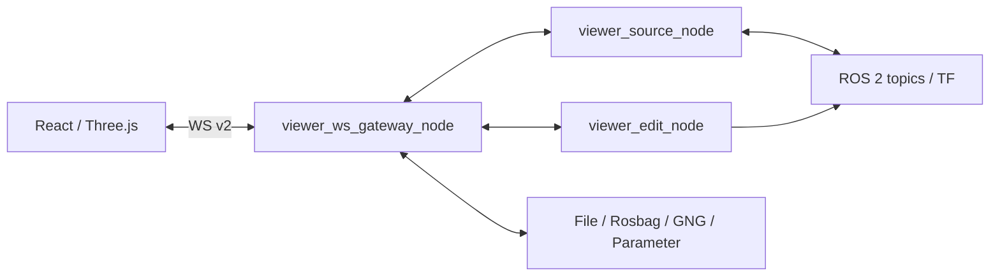

# Viewer構成

Frontendは表示・入力、WebSocket gatewayは通信、ROS側の分割ノードは処理を担当。
起動構成は[viewer_stack.launch.py](../backend/src/topo_fuzzy_viewer/launch/viewer_stack.launch.py)。

| ノード | 責務 |
| --- | --- |
| viewer_ws_gateway_node | 接続・要求振分け・配信制御 |
| viewer_source_node | ROS入力の購読・変換 |
| viewer_edit_node | map座標系のAABB編集・非同期ジョブ・候補抽出 |
| viewer_file_node | 点群ファイル操作 |
| viewer_rosbag_node | bag再生操作 |
| viewer_gng_node | GNGプロセス操作 |
| viewer_param_node | ROSパラメータ操作 |
| viewer_template_match_node / viewer_vehicle_registration_node | テンプレート照合・車両位置合わせ |

編集でTFが欠ける場合は失敗。Frontendによる点単位の代替処理なし。
Simulatorの`/observe`は表示専用入口。[許可操作・通信契約](../common/ws_protocol_v2.md)。

実装: [backend](../backend/src/topo_fuzzy_viewer/src/)・[Frontend責務](frontend_api.md)。
