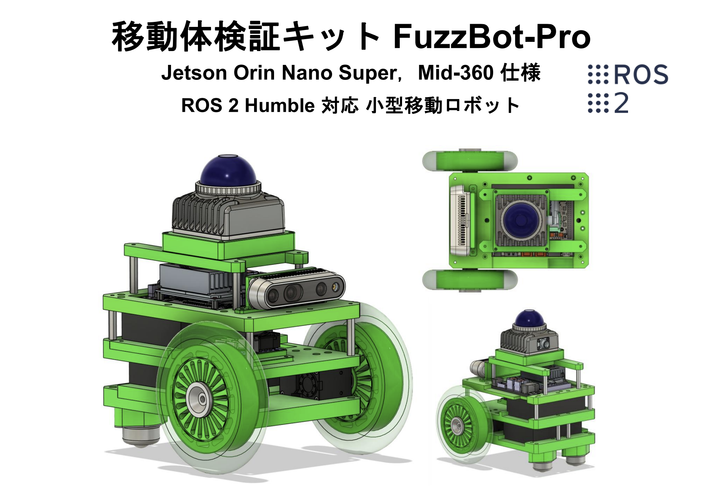

# FuzzBotセットアップ



搭載部品・寸法・性能: [構成](./img/image-1.png)・[寸法](./img/寸法.png)・[性能](./img/fuzzbot性能表.png)。
対象はJetson Orin Nano・JetPack 6.x・ROS 2 Humble。
Jetson導入は[SDK Manager](https://developer.nvidia.com/sdk-manager)、ROS導入は[公式手順](https://docs.ros.org/en/humble/Installation/Ubuntu-Install-Debians.html)。

## 環境

作業領域は`~/fuzzbot_ws`。Jetson・リモートPCでROS_DOMAIN_IDを統一し、時計同期を確認。
元設定例はdomain 30、モデルはJetson側`fuzzbot_pro`・リモート側`fuzzbot_pro_normal`。使用機体の設定との一致が必要。

| 依存 | 元手順の版・参照 |
| --- | --- |
| librealsense | v2.55.1、RSUSB・CUDA有効 |
| realsense-ros | 4.55.1。[上流](https://github.com/IntelRealSense/realsense-ros) |
| D435i firmware | 5.16.0.1。SDKと対応する版を使用 |
| DynamixelHandler | [上流](https://github.com/ROBOTIS-JAPAN-GIT/DynamixelHandler-ros2)・[ワークスペース版](../../../../hardware_drivers/dynamixel/dynamixel_handler/ReadMe.md) |
| MID-360 | [Livox-SDK2](https://github.com/Livox-SDK/Livox-SDK2)・[driver](https://github.com/fuzzrobo/livox_ros_driver2) |
| GLIM | [導入元](https://koide3.github.io/glim/)、元手順はCUDA 12.6版 |

版の一覧は元構成の記録であり、最新環境での互換性確認結果ではない。

## RealSense SDKの機種固有ビルド

```bash
cmake .. -DBUILD_EXAMPLES=true -DCMAKE_BUILD_TYPE=Release -DFORCE_RSUSB_BACKEND=true -DBUILD_WITH_CUDA=true
make -j4
sudo make install
```

SDKのUSBルールを配置し、再接続後に認識を確認。ROS側のrosdepでは`librealsense2`を除外して自前SDKを使用。
ファーム更新は対応版の確認後に実施し、通常起動へ組み込まない構成。

## FuzzBotパッケージ

```bash
cd ~/fuzzbot_ws/src
git clone https://github.com/fuzzrobo/fuzzbot.git
cd ~/fuzzbot_ws
colcon build --symlink-install
source install/setup.bash
```

MID-360 driverは別の`~/livox_ws`で`./build.sh humble`後に環境を読込み。SDK導入後は共有ライブラリの解決確認が必要。
ワークスペース共通のMID-360接続・TFは[手順](../../../../hardware_drivers/mid360/README.md)。

## 実機起動

| 用途 | コマンド |
| --- | --- |
| Jetson側bringup | `ros2 launch fuzzbot_bringup fuzzbot.launch` |
| GLIM | `ros2 launch fuzzbot_slam glim.launch` |
| GLIM＋RViz | `ros2 launch fuzzbot_slam glim_rviz.launch` |
| キーボード操作 | `ros2 run fuzzbot_teleop teleop_key_node` |
| ジョイスティック操作 | `ros2 run fuzzbot_teleop teleop_joy_node`＋入力PCの`ros2 run joy joy_node` |
| D435i | `ros2 launch realsense2_camera rs_launch.py` |

独立したFuzzBot実機構成。ブラウザへの表示専用起動は[RUN_GUIDE](../../../../RUN_GUIDE.md#fuzzbotの表示専用起動)。
この旧構成のシミュレーション手順は未整備。
